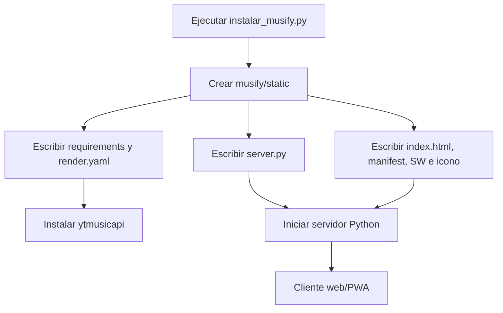

# Documentaci?n t?cnica de Musify

## Alcance

Este documento describe el instalador Python incluido en el c?digo fuente proporcionado y la aplicaci?n que genera. El instalador crea un proyecto m?nimo en una carpeta `musify/` junto al propio script. No se debe confundir con otros artefactos o versiones del repositorio: la descripci?n aqu? corresponde al contenido generado por ese instalador.

## Componentes y flujo de instalaci?n

`instalar_musify.py` usa `pathlib.Path` para determinar el directorio de salida y crea `musify/static/`. A continuaci?n escribe en disco los archivos definidos en el diccionario `FILES`, creando los directorios padre que hagan falta. Al terminar imprime los nombres generados y comandos b?sicos para iniciar el servidor. Si ya existen archivos con esos nombres, `write_text()` los reemplaza; el instalador no crea una copia de respaldo ni pregunta antes de sobrescribirlos.



Estructura generada:

```text
musify/
??? requirements.txt
??? render.yaml
??? server.py
??? static/
    ??? index.html
    ??? manifest.json
    ??? sw.js
    ??? icon.svg
```

## Servidor HTTP

`server.py` utiliza `ThreadingHTTPServer` y `SimpleHTTPRequestHandler`. El directorio `static/` se configura como ra?z de archivos est?ticos. El puerto se lee de `PORT` y, si no est? definido, usa `8000`; el servidor escucha en `0.0.0.0`.

El manejador agrega `Access-Control-Allow-Origin: *` y encabezados `Cache-Control: no-store, no-cache, must-revalidate` a las respuestas. Las rutas `/api/...` se procesan como JSON. Si la ruta comienza con `/api/` pero no coincide con una ruta implementada, devuelve 404 JSON. Para navegaci?n web, si no existe el archivo solicitado y la ruta no parece una extensi?n est?tica conocida, sirve `index.html` como fallback de una sola p?gina.

### API HTTP

| Ruta | M?todo | Par?metros | Respuesta y funci?n |
|---|---|---|---|
| `/api/health` | GET | ? | Estado `ok` y cantidad de instancias Piped configuradas. |
| `/api/search` | GET | `q` obligatorio | Busca canciones con `ytmusicapi`; devuelve identificador, t?tulo, artistas, miniatura y duraci?n. |
| `/api/radio` | GET | `id` obligatorio | Obtiene hasta 25 pistas de radio relacionadas mediante `ytmusicapi`. |
| `/api/lyrics` | GET | `title` obligatorio, `artist` opcional | Consulta LRCLIB; devuelve letra sincronizada y/o texto plano. |
| `/api/lyricsearch` | GET | `q` obligatorio | Busca canciones en YouTube Music con la consulta original y otra ampliada con ?letra lyrics?, quitando duplicados. |
| `/api/piped/search` | GET | `q` obligatorio | Busca canciones en Piped y normaliza identificador, t?tulo, artista/canal, imagen y duraci?n. |
| `/api/piped/stream` | GET | `id` obligatorio | Solicita a Piped los streams de audio y selecciona el de mayor bitrate. |

Los par?metros faltantes requeridos producen `400`; errores aguas arriba se convierten en `502` mediante `APIError`, y errores inesperados se registran y devuelven como `500`. Una pista sin audio disponible en Piped devuelve `404`. Las respuestas JSON se codifican en UTF-8 y no incluyen el contenido completo de audio: el endpoint de stream entrega una URL externa.

## Integraciones externas

- **ytmusicapi / YouTube Music:** b?squeda de canciones y radio. No requiere una clave configurada en el c?digo, pero depende de que la biblioteca y el servicio externo sigan funcionando.
- **Piped:** b?squeda y resoluci?n de streams. La variable `PIPED_INSTANCES` permite proporcionar varias bases API separadas por comas; si no est? definida, se usa una lista predeterminada. El servidor prueba las instancias en orden, con timeout de 8 segundos por solicitud.
- **LRCLIB:** consulta de letras sincronizadas o planas por HTTP, con timeout de 10 segundos.
- **Audius:** el cliente web consulta el endpoint p?blico de Audius directamente para sus b?squedas y streaming.

Estas integraciones dependen de servicios p?blicos de terceros; disponibilidad, pol?ticas y formato de respuestas pueden cambiar sin aviso.

## Cliente web y PWA

`static/index.html` implementa la interfaz adaptable para m?vil y escritorio. Permite buscar y reproducir canciones, gestionar una cola, ver canciones recientes, crear playlists, elegir tema oscuro/AMOLED/claro y color de acento, mostrar letras y activar radio autom?tica al terminar la cola. La reproducci?n de radio y letras usa los endpoints del servidor.

Las playlists, el historial, las preferencias visuales y la preferencia de radio se guardan en `localStorage` del navegador; no hay cuentas ni sincronizaci?n entre dispositivos. La b?squeda y reproducci?n de canciones utilizan el backend y la URL de stream devuelta por Piped.

`manifest.json` define la aplicaci?n instalable (nombre, alcance, modo standalone, orientaci?n, colores e icono SVG). `sw.js` cachea la carcasa est?tica para navegaci?n y permite servir `index.html` como fallback sin conexi?n. No cachea solicitudes `/api/`. El cach? no equivale a una funci?n de descarga de canciones; la reproducci?n y las APIs requieren conectividad.

## Ejecuci?n local

Desde la carpeta generada:

```powershell
python -m pip install -r requirements.txt
python server.py
```

Abre `http://localhost:8000`. Tambi?n se puede seleccionar otro puerto definiendo `PORT`. Para configurar instancias Piped, define `PIPED_INSTANCES` con URLs separadas por comas antes de iniciar el proceso.

## Despliegue en Render

`render.yaml` declara un Web Service llamado `musify`, runtime Python y plan `free`. El comando de construcci?n instala `requirements.txt`; el comando de inicio es `python server.py`. Render proporciona `PORT` para enlazar el servicio. El blueprint describe un despliegue p?blico: el servidor generado no implementa autenticaci?n, control de acceso de usuarios ni l?mites de uso.

## Seguridad, privacidad y limitaciones

- El servidor no tiene autenticaci?n ni autorizaci?n. Si se publica en una URL accesible desde Internet, cualquier persona puede invocar las APIs y consumir los recursos del servicio.
- El encabezado CORS permite cualquier origen. No es control de acceso y no protege el servicio.
- Las consultas y streams dependen de servicios externos. No se implementa cach? persistente, almacenamiento de audio en servidor ni gesti?n de cuentas.
- `localStorage` es local al navegador y puede borrarse al limpiar los datos del sitio. No se sincroniza entre usuarios/dispositivos.
- La disponibilidad de las instancias p?blicas de Piped y de las APIs externas no est? garantizada.
- El README original advierte que extraer audio desde YouTube mediante Piped puede contravenir los t?rminos aplicables. Revisa t?rminos, derechos de autor y normativa local antes de usar o distribuir el servicio; para publicaci?n general, considera limitar las fuentes a servicios y usos autorizados.
- El plan gratuito de Render puede suspender el servicio tras inactividad y demorar la primera solicitud posterior.

## Archivos de referencia

- `server.py`: servidor, API e integraciones.
- `static/index.html`: interfaz, reproducci?n y persistencia local.
- `static/manifest.json`: metadatos PWA.
- `static/sw.js`: cach? est?tico y fallback de navegaci?n.
- `render.yaml`: configuraci?n de despliegue.
- `requirements.txt`: dependencia Python `ytmusicapi`.
